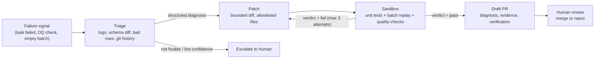

# Self-Healing Pipeline Agent

A data pipeline breaks — a field is renamed, a type changes, bad rows appear, a
batch never arrives. An LLM agent reads the logs, finds the root cause, writes a
patch, tests it against unit tests and a replay of the failed batch in an isolated
sandbox, and opens a draft pull request only if every check passes. A human merges.

The point is not "an LLM that writes code." It is a system that can *prove* a fix
is correct and safe before a human ever sees it — and knows when to stop and
escalate instead of guessing.

## How it works



The agent's authority ends at the pull request: it never writes production data,
never merges, and never edits its own guardrails.

## What makes it different

- **Verification, not vibes.** A patch must pass unit tests, a regression suite, a
  replay of the failing batch, and data-quality checks — and match golden output.
- **Guardrails in code.** ≤ 30 changed lines, ≤ 2 files, allowlisted paths, no
  weakened checks, budget caps. A patch that disables a failing validation is
  rejected automatically.
- **Escalation as a first-class outcome.** An upstream outage is not a code bug.
  The agent recognizes that and hands it to a human.
- **Measured, not demoed.** A benchmark of 40+ injected incidents with ground-truth
  fixes, compared against a regex baseline and a single-prompt LLM.

## Project status

**Design phase complete; implementation in progress.** The repository currently
contains the project skeleton (packaging, linting, tests, CI) and a full written
design. The pipeline, agent, sandbox, and benchmark are specified but not yet
implemented. There are no benchmark numbers yet, and this README will not pretend
otherwise.

## Documentation

| Document | What it defines |
| --- | --- |
| [Architecture](docs/architecture.md) | System diagram, pipeline/agent/sandbox boundaries, detection, GitHub integration |
| [Data contracts](docs/data-contracts.md) | Event schema and versioning, warehouse tables, data-quality rules, incident/diagnosis/patch/verification formats |
| [Agent workflow](docs/agent-workflow.md) | LangGraph state machine, node contracts, tools, retry and escalation logic |
| [Safety design](docs/safety-design.md) | Threat model, guardrails, allowed paths, budgets, approval requirements |
| [Evaluation plan](docs/evaluation-plan.md) | Benchmark, metrics, procedure, acceptance criteria |

## Target stack

Python 3.12+ managed with [uv](https://docs.astral.sh/uv/), Redpanda (Kafka API),
Spark Structured Streaming or a plain Python consumer, Airflow, Postgres/DuckDB,
Great Expectations, LangGraph, Docker for the sandbox, PyGithub, pytest, and
Langfuse/OpenTelemetry for traces.

The MVP deliberately starts smaller: Python consumer, DuckDB, and two failure
types. Redpanda, Spark, and Airflow come after the repair loop is reliable.

## Repository layout

```text
pipeline-healer/
├── src/pipeline_healer/    # pipeline, chaos, agent, sandbox, evals
├── dags/                   # Airflow DAGs
├── data/
│   ├── incidents/          # recorded incident batches and golden outputs
│   └── samples/            # committed ride/order fixtures with manifest
├── docs/                   # design set
├── tests/                  # unit/, integration/, safety/
├── docker-compose.yml
└── Makefile                # make help, check, samples, demo
```

## Getting started

Requirements: Python 3.12+, [uv](https://docs.astral.sh/uv/), and `make`.
Everything runs through the `Makefile`; `make help` lists every target.

| Task | Command |
| --- | --- |
| Install and sync the environment | `make install` |
| Run the package entry point | `make run` |
| Run the test suite | `make test` |
| Lint and format | `make lint` / `make format` |
| Lint, format check, and tests together | `make check` |
| Print a few generated events | `make demo` |
| Generate events (`COUNT=`, `SEED=`) | `make ride` / `make order` |
| Regenerate the committed fixtures | `make samples` |
| Install the commit hooks (once) | `make hooks` |
| Run all hooks against every file | `make pre-commit` |
| Remove caches and build artifacts | `make clean` |

CI runs the equivalent of `make check` on every push to `main`.

## Safety principles

1. Read and propose; never apply to production.
2. The sandbox has no network, no secrets, and no host filesystem.
3. A patch cannot weaken, skip, or delete a quality check or test.
4. Human approval is mandatory and cannot be delegated to the agent.
5. When the evidence is insufficient, escalate — do not guess.
