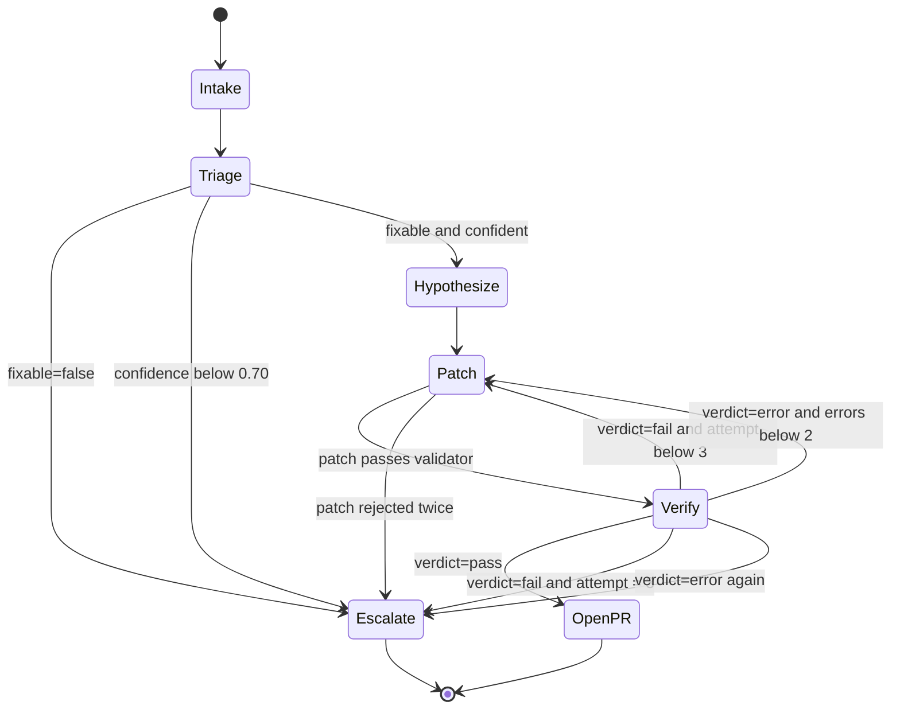

# Agent Workflow

The agent is a LangGraph state machine with three roles and three terminal
outcomes. This document defines node behavior, state, and transition rules; the
artifact formats live in [`data-contracts.md`](data-contracts.md).

## 1. Graph state

```python
class AgentState(TypedDict):
    incident: Incident  # immutable input record
    evidence: EvidenceBundle  # logs, schema diff, bad rows, metrics
    diagnosis: Diagnosis | None  # triage output
    hypotheses: list[Hypothesis]  # ranked causes from triage
    patch: Patch | None  # current proposed diff
    verification: Verification | None
    attempt: int  # patch attempts used, starts at 0
    status: str  # triage|patching|verifying|pr_open|escalated
    escalation_reason: str | None
    trace: list[TraceEvent]  # appended on every transition
```

Rules:

- Nodes never mutate `incident`; it is the frozen record from detection.
- Each node returns only the fields it owns; LangGraph merges them.
- `attempt` increments only when a patch is submitted to the sandbox.
- Every transition appends `{node, started_at, ended_at, outcome, fields_changed}`
  to `trace`, so a failed run can be replayed from the log.

## 2. State transition diagram



## 3. Nodes

| Node         | Inputs                                  | Outputs                                   | Tools                                        | Failure behavior                                   |
| ------------ | --------------------------------------- | ----------------------------------------- | -------------------------------------------- | -------------------------------------------------- |
| `Intake`     | Incident record                         | Validated state, `status=triaging`        | none                                         | Malformed incident → escalate immediately           |
| `Triage`     | Incident, evidence bundle               | `Diagnosis`, ranked `hypotheses`          | `get_logs`, `get_schema_diff`, `sample_bad_rows`, `read_file`, `git_log`, `search_runbook` | Tool error → retry once, then escalate |
| `Hypothesize`| Diagnosis, evidence                     | Ordered fix candidates                    | `read_file`, `git_log`                       | No candidate within allowlist → escalate            |
| `Patch`      | Diagnosis, evidence, hypotheses         | `Patch` artifact                          | `propose_patch`                              | Invalid patch → one repair attempt, then escalate   |
| `Verify`     | Patch                                   | `Verification`, `attempt += 1`            | `run_sandbox`                                | `fail` → feedback to Patch; `error` → retry once    |
| `OpenPR`     | Patch, Verification, Diagnosis          | PR URL and report                         | `open_pr`                                    | API failure ×3 → escalate with local diff attached  |
| `Escalate`   | All state                               | Escalation package handed to a human      | `escalate`                                   | Always terminal; never falls back to patching       |

## 4. Triage

Goal: classify the failure and decide whether a code fix is even appropriate.

Evidence gathering order (cheap to expensive):

1. Incident signal and task state.
2. Structured logs for the failing task and batch.
3. Schema diff for the affected topic.
4. Sample of failing rows (masked).
5. Quality-expectation results and metrics.
6. File read and `git_log` for the suspected transform.
7. Runbook search for the category.

Output contract: the diagnostic report in
[`data-contracts.md#diagnostic-report`](data-contracts.md#6-diagnostic-report).

Rules:

- `evidence` must cite artifacts that exist; no invented log lines.
- Evidence that conflicts with the signal is recorded, not discarded — it is
  usually the clue.
- `fixable=false` is required for `upstream_outage` and `unknown`.
- The model may propose `unknown`; the graph then escalates and reports which
  evidence was missing.

## 5. Hypothesize

Produces a ranked list of candidate fixes, each with:

- Target file (must exist and be allowlisted).
- The change in one sentence.
- Why the evidence supports it.
- Risk if wrong.

Ranking prefers the smallest change that explains all evidence. If the top
candidate touches a blocked path or exceeds the size limit, it is dropped before
patching rather than proposed and rejected.

## 6. Patch

The Patch node receives a deliberately narrow context:

- The diagnosis and its evidence.
- The allowlisted files implicated by the diagnosis (contents, not the whole
  repository).
- Recent `git_log` for those files.
- The previous verification failure (on retries only).
- The rules: max 30 changed lines, max 2 files, allowlist/blocklist.

On retry, the prompt includes the last verification result so the model can react
to a failing test instead of repeating the same diff. The patch must differ from
the previous attempt; an identical diff escalates immediately.

Before leaving the node, the patch validator checks: applies to `base_commit`,
size, paths, no validation weakening, no dependency changes. Rejection is
returned to the node as feedback; two consecutive rejections escalate.

## 7. Verify

`run_sandbox` is the only path to a verdict. Node logic:

```python
attempt += 1
result = run_sandbox(patch, incident.batch_id)
if result.verdict == "pass":
    return open_pr()
if result.verdict == "fail" and attempt < MAX_ATTEMPTS:
    return patch_with_feedback(result)
return escalate(result.failure_reason or "verification_error")
```

`MAX_ATTEMPTS = 3` total patch attempts. `error` verdicts do not consume an attempt;
two consecutive errors escalate.

## 8. Terminal outcomes

| Outcome   | Condition                                              | Artifacts emitted                                  |
| --------- | ------------------------------------------------------ | -------------------------------------------------- |
| `OpenPR`  | `verification.verdict == "pass"`                       | Branch, commit, draft PR, report                   |
| `Escalate`| not fixable, low confidence, retries exhausted, patch rejected twice, sandbox errors, PR API failure | Escalation package (below) |

Escalation package:

```json
{
  "incident_id": "INC-20261103-0007",
  "status": "escalated",
  "reason": "verification_failed",
  "diagnosis": { "...": "final diagnosis" },
  "attempts": [
    { "attempt": 1, "patch_summary": "...", "verification": { "...": "..." } }
  ],
  "recommended_next_step": "Inspect replay diff for batch_104",
  "human_actions": ["review evidence", "reproduce locally", "apply fix manually"]
}
```

An escalation is a success of the safety design, not a failure of the agent. It
must arrive with enough context for a human to act without re-running the
investigation.

## 9. Tool contracts

| Tool                    | Parameters                      | Returns                                    | Side effects |
| ----------------------- | ------------------------------- | ------------------------------------------ | ------------ |
| `get_logs`              | `task`, `window`                | JSON log lines, filtered and bounded       | none         |
| `get_schema_diff`       | `topic`, `from_version`, `to_version` | Registry diff entries                | none         |
| `sample_bad_rows`       | `table`, `n` (≤ 50)             | Masked rows plus quarantine reasons        | none         |
| `read_file`             | `path`                          | File contents if inside the repo snapshot  | none         |
| `git_log`               | `path`, `limit` (≤ 20)          | Commits touching the path                  | none         |
| `search_runbook`        | `query`                         | Ranked runbook excerpts                    | none         |
| `propose_patch`         | `Patch` artifact                | Validation result                          | none (artifact only) |
| `run_sandbox`           | `patch`, `batch_id`             | `Verification` result                      | ephemeral container |
| `open_pr`               | `patch`, `report`               | PR URL                                     | creates branch and draft PR |
| `escalate`              | `reason`, package               | Acknowledgement                            | creates escalation record |

Every tool is read-only except `run_sandbox`, `open_pr`, and `escalate`. None can
write to the warehouse, repository default branch, or infrastructure.

## 10. Prompt context boundaries

- Triage sees evidence for one incident only; no cross-incident memory.
- Patch sees only allowlisted files implicated by the diagnosis, not the full
  repository.
- Verify sees no model input at all; it is deterministic code.
- No prompt contains production credentials, raw PII, or unrelated incidents.

## 11. Observability of the agent itself

Each node emits a trace span (`incident_id`, `node`, `attempt`, `duration`,
`token_usage`, `outcome`). The evaluation harness consumes these directly, so
cost and latency metrics never require instrumenting prompts separately.

## 12. Related documents

- Boundaries and dispatch: [`architecture.md`](architecture.md#system-boundaries)
- Artifact schemas: [`data-contracts.md`](data-contracts.md)
- Guardrails and escalation policy: [`safety-design.md`](safety-design.md)
- Measurement: [`evaluation-plan.md`](evaluation-plan.md)
