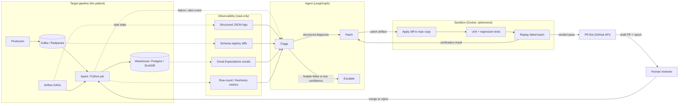

# Architecture — Self-Healing Pipeline Agent

## Status

The repository contains the project skeleton (packaging, Ruff, pytest, pre-commit,
CI, a single entry point). The documents in `docs/` define the target design:

| Document               | Contents                                                   |
| ---------------------- | ---------------------------------------------------------- |
| `architecture.md`      | System layout, boundaries, detection, sandbox, GitHub, approval |
| `data-contracts.md`    | Event model, versioning, output tables, quality rules, artifact formats |
| `agent-workflow.md`    | Roles, LangGraph states and transitions, tool contracts    |
| `safety-design.md`     | Threat model, guardrails, escalation, path limits, approval |
| `evaluation-plan.md`   | Benchmark, metrics, procedure, acceptance criteria         |

No agent implementation is required for these contracts to be valid; code must
conform to them.

## One-liner

Data pipelines break (schema change, bad rows, late data). An LLM agent reads the
logs, finds the root cause, writes a patch, tests it in a sandbox, and opens a PR
only if the tests pass. A human merges. Success is measured by how often the agent
fixes correctly.

## Design principle: the trust boundary is the product

A green test run never grants write access to production. The agent's authority
ends at a reviewable pull request; the human owns the merge. Every component below
is shaped by that rule.

## System architecture diagram



## System boundaries

The three runtime parts have disjoint write authority. Anything crossing a
boundary crosses as an immutable artifact, never as a shared database handle.

| Component       | Owns                                                       | May write                                   | Explicitly forbidden                                        |
| --------------- | ---------------------------------------------------------- | ------------------------------------------- | ----------------------------------------------------------- |
| **Pipeline**    | Ingest, transform, warehouse tables, quality results       | Its own warehouse schema and metadata tables | Calling agent tools, editing agent or sandbox code          |
| **Observability** | Log/metric/schema-diff projections                       | Log and metric stores                       | Holding secrets; accepting writes from the agent            |
| **Agent**       | Evidence gathering, diagnosis, patch proposals, PR creation | Incident records and artifacts only, plus GitHub PRs | Writing warehouse data, editing repo files directly, merging |
| **Sandbox**     | Applying a patch to a disposable copy, running tests/replay | Its ephemeral workspace and result artifacts | Network access, production credentials, host filesystem     |
| **Human**       | Merge/reject decision                                      | `main` (merge)                              | Delegating merge authority to the agent                     |

Crossing contracts:

| Artifact             | Produced by | Consumed by      | Format defined in                    |
| -------------------- | ----------- | ---------------- | ------------------------------------ |
| Incident event       | Detection   | Agent            | `data-contracts.md#incident-metadata` |
| Evidence bundle      | Agent tools | Triage, Patch    | `data-contracts.md#diagnostic-report` |
| Diagnosis            | Triage      | Patch, Escalation | `data-contracts.md#diagnostic-report` |
| Patch                | Patch       | Sandbox, PR Bot  | `data-contracts.md#generated-patch`  |
| Verification result  | Sandbox     | Patch, PR Bot, Escalation | `data-contracts.md#verification-result` |
| PR report            | PR Bot      | Human            | `data-contracts.md#pull-request-report` |
| Ground truth         | Chaos       | Evaluation       | `data-contracts.md#incident-metadata` |

Trust boundaries to enforce in code review:

1. **Pipeline → Agent**: read-only evidence. No tool returns production write
   credentials or unredacted PII.
2. **Agent → Sandbox**: a patch artifact only. The sandbox receives no live
   credentials and no network.
3. **Agent → GitHub**: branch and PR creation only. Branch protection blocks
   merging and force-pushing `main`.

## Target data pipeline

The pipeline is the subject under repair: small (about 500 lines) but structured
like a real one. Schemas, tables, and constraints are specified in
[`data-contracts.md`](data-contracts.md).

Flow:

1. **Producers** (Python scripts) emit synthetic ride and order events.
2. **Kafka / Redpanda** buffers them in topics `ride_events`, `order_events`,
   `payment_events`.
3. **Stream job** (Spark Structured Streaming or a plain Python consumer) parses,
   casts, deduplicates, applies watermarks, and writes cleaned rows.
4. **Warehouse** (Postgres, or DuckDB for the MVP) stores cleaned and aggregated
   tables.
5. **Airflow** runs scheduled aggregation and emits task state.
6. **Great Expectations** validates the warehouse and publishes results.

The pipeline must be big enough to fail in realistic ways and small enough that a
reviewer can read it. Spark, Airflow, and Redpanda are deliberately droppable for
the MVP; the failure modes do not depend on them.

## Incident detection

Detection is deterministic and lives outside the agent. The agent is only invoked
after an incident record exists.

| Signal               | Source                        | Trigger condition                                      | Severity |
| -------------------- | ----------------------------- | ------------------------------------------------------ | -------- |
| Task failure         | Airflow task callback         | task state `failed`, non-transient exit code           | high     |
| Critical expectation | Great Expectations run        | any `severity=critical` expectation fails              | high     |
| Empty batch          | Row-count monitor             | received events `= 0` for a scheduled window           | critical |
| Volume anomaly       | Row-count monitor             | batch count outside ±40% of 7-day median               | warning  |
| Freshness            | Freshness monitor             | newest `processed_at` older than 15 minutes            | high     |
| Consumer lag         | Redpanda consumer group       | lag above threshold for 5 minutes                      | warning  |
| Duplicate spike      | Quality metrics               | duplicate rate above 0.1%                              | warning  |

Detection path:

1. Signal sources emit normalized alert events.
2. The detector maps signal + severity to a `failure_category` hint (never a final
   diagnosis) and creates an **incident**.
3. Incidents are deduplicated on `(task, batch_id, category)` within a 30-minute
   suppression window; the first one becomes the canonical incident.
4. The detector freezes an evidence snapshot reference (log window, schema diff,
   failing rows sample, metrics) and records the pipeline's current commit as
   `base_commit`.
5. The agent is dispatched with the incident payload only.

Warnings do not start the agent by default; they annotate incidents and appear in
evidence. Critical and high severities dispatch immediately. See
`data-contracts.md#incident-metadata` for the payload.

## Agent workflow (summary)

Three roles in a LangGraph state machine: **Triage → Hypothesize → Patch →
Verify**, with **retry**, **open PR**, or **escalate** as terminal outcomes.

- Triage produces a structured diagnosis; `fixable=false` or confidence below
  `0.70` escalates immediately.
- Patch receives only the diagnosis, evidence, and allowlisted files.
- Verify is the sandbox; failure feedback goes back to Patch, up to three total
  patch attempts, then escalation.

The full state diagram, node contracts, prompts' input/output rules, and graph
state schema are in [`agent-workflow.md`](agent-workflow.md).

## Sandbox architecture

The sandbox is what distinguishes this system from "an LLM that writes code". It
is a disposable Docker environment created per verification attempt.

Per-verification lifecycle:

1. Create a fresh container from a pinned image (Python runtime + project deps,
   no credentials baked in).
2. Copy the repository at `base_commit` into a writable layer; apply the patch
   with `git apply --check` followed by `git apply`.
3. Reject immediately if the patch adds, removes, or renames files outside the
   allowlist, or exceeds the size limit (`safety-design.md`).
4. Run the affected unit tests, then the regression suite.
5. Replay the failing batch through the pipeline modules against a disposable
   warehouse copy seeded from the incident's golden dataset.
6. Compare replay output with expectations: processed/rejected counts, key
   uniqueness, null ratios, and the canonical output columns.
7. Emit a verification result artifact and destroy the container.

Isolation controls:

| Control              | Setting                                                        |
| -------------------- | -------------------------------------------------------------- |
| Network              | `--network none`                                               |
| Filesystem           | Read-only base image; writable tmpfs workspace; no host mounts |
| User                 | Non-root UID                                                   |
| Secrets              | None injected; verified by env allowlist                       |
| Resources            | 2 CPU, 2 GB RAM, 10-minute wall clock, `--pids-limit`           |
| Docker socket        | Never mounted                                                  |
| Determinism          | Fixed seeds, pinned image digest, recorded input batches       |
| Data                 | Synthetic or masked only; golden outputs versioned with fixture |

Verdict rules (format in `data-contracts.md#verification-result`):

- `pass` — unit tests, regression suite, replay, and data-quality checks all pass.
- `fail` — any test or replay comparison fails; this is actionable feedback for
  the Patch agent.
- `error` — infrastructure problem (image pull, timeout, crash). Retried once;
  repeated errors escalate without consuming a patch attempt.

## GitHub integration

The PR Bot is the only component with repository write access, and only through
the GitHub API.

- **Auth**: a GitHub App installation token or a fine-grained PAT scoped to this
  repository with `contents:write` and `pull_requests:write`. No administrative
  scopes; no access to Actions secrets.
- **Branch**: `heal/<incident_id>` created from `base_commit`, never from `main`
  HEAD, so the diff cannot silently include unrelated changes.
- **Commit**: single commit, message `heal: <category> (<incident_id>)`, no
  force-push.
- **PR**: opened as a **draft**, body rendered from the verification result and
  diagnosis, labels `self-healing` and `severity:<level>`, reviewer set to the
  on-call rotation.
- **Idempotency**: before creating, search for an open PR with
  `heal/<incident_id>`; a duplicate incident updates the existing PR instead of
  opening another.
- **Never**: merge, approve, dismiss reviews, modify branch protection, edit CI
  configuration, or push to `main`.
- **Failure handling**: API errors retry with backoff (max 3); persistent failure
  escalates with the local diff attached so the fix is not lost.
- **Rate limits**: per-incident PR creation is bounded to one; rate-limit
  responses (403/429) defer the incident rather than retrying aggressively.

PR body structure is defined in
`data-contracts.md#pull-request-report`; approval requirements are in
[`safety-design.md`](safety-design.md#10-human-approval).

## Human approval

Human review is mandatory for every change. The agent cannot merge, cannot approve
its own PR, and cannot dismiss a review. Branch protection on `main` enforces this
independently of agent behavior.

Reviewer checklist and the full approval policy: see
[`safety-design.md`](safety-design.md#10-human-approval).

## End-to-end lifecycle

1. **Ingest and run** — events flow; the pipeline processes and stores them.
2. **Failure detection** — a signal crosses its threshold and creates an incident.
3. **Triage** — the agent gathers evidence and returns a structured diagnosis.
4. **Patch** — the agent proposes a bounded diff.
5. **Verify** — the sandbox tests the diff and replays the failed batch.
6. **Decision** — pass → PR; fail → retry (max 3) or escalate.
7. **Human review** — merge or reject.

## Repository layout

```text
pipeline-healer/
├── src/pipeline_healer/
│   ├── pipeline/          # producers, consumers, transforms, expectations
│   ├── chaos/             # injectors, catalog, ground_truth
│   ├── agent/             # graph, nodes, tools, prompts, guardrails, state.py
│   ├── sandbox/           # docker/, runner.py, replay.py
│   └── evals/             # benchmark, baselines, metrics, reports
├── dags/                  # Airflow DAG definitions
├── data/
│   ├── incidents/         # recorded incident batches and golden outputs
│   └── samples/           # committed ride/order fixtures with manifest
├── docs/                  # this design set
├── tests/                 # unit/, integration/, safety/
├── docker-compose.yml
├── Makefile               # make help, check, samples, demo
└── README.md
```

Importable code lives under `src/pipeline_healer/` so `uv_build` keeps working with
the existing entry point. `dags/` is configuration, not application code, so it
stays at the root with the Docker and data assets.

## Stack

| Concern            | Choice                                                      |
| ------------------ | ----------------------------------------------------------- |
| Language / env     | Python ≥ 3.12, dependencies via **uv** (locked `uv.lock`)    |
| Messaging          | Redpanda (Kafka API, lighter locally)                       |
| Processing         | Spark Structured Streaming, or a plain Python consumer      |
| Orchestration      | Airflow                                                     |
| Warehouse          | PostgreSQL / DuckDB                                         |
| Data quality       | Great Expectations                                           |
| Agent              | LangGraph                                                   |
| Sandbox            | Docker                                                      |
| GitHub integration | GitHub API via PyGithub                                     |
| Tests              | pytest                                                      |
| Traces             | Langfuse / OpenTelemetry                                    |
| Quality gates      | Ruff, pre-commit, GitHub Actions                            |

## Implementation order

Do not start with LangGraph or an LLM. Start with a system worth repairing.

1. Pipeline end to end with Python and DuckDB; confirm events flow.
2. Data-quality checks; define what "correct" means.
3. First fault injector (schema drift), reproducible.
4. Ground truth plus a test for the expected fix.
5. Evidence-gathering tools without an LLM.
6. LangGraph and the LLM: triage first, then patch generation.
7. Sandbox and guardrails; no PR before verification passes.
8. Evaluation and GitHub integration.

**MVP cut**: Python pipeline, DuckDB, pytest or Great Expectations, schema drift
and type change, LangGraph, one cheap model, Docker sandbox, GitHub PR. Add
Redpanda, Spark, and Airflow only after the full repair loop is reliable.

MVP acceptance: inject schema drift → detect → diagnose → patch → verify in Docker
→ open a PR, without touching production.

## Development workflow

```text
edit -> git commit -> pre-commit (hygiene, ruff --fix, ruff-format, pytest)
     -> git push main -> CI (uv sync --locked, ruff check, ruff format --check, pytest)
```

Local hooks are the fast loop; CI is the authoritative gate.

## Decisions

- **Single maintainer, trunk-based development.** Commits go directly to `main`;
  branches are reserved for discardable spikes.
- **Locked dependencies.** `uv.lock` is committed and CI installs with `--locked`.
- **No type checker configured yet.** Ruff covers syntax and common bugs.
- **Minimal runtime dependencies.** Nothing is added until the feature needs it.
- **Correctness over autonomy.** Verified fixes and honest escalation outrank an
  agent that acts on everything.
